<div align="center">

# 🔍 ChatLens

### Local, evidence-grounded WhatsApp conversation RAG & analytics engine

*Ask questions in plain English. Inspect the exact message evidence and citations. 100% private, local-first execution.*

[](https://www.python.org/)
[](https://langchain-ai.github.io/langgraph/)
[](https://python.langchain.com/)
[](https://ollama.com)
[](https://www.trychroma.com/)
[](https://www.sqlite.org/)
[](https://streamlit.io/)
[](https://plotly.com/)
[](https://github.com/vVIBHORj/chatlens_v2)

</div>

---

## 📑 Table of Contents

- [✨ Overview](#-overview)
- [🏗️ System Architecture & Design](#️-system-architecture--design)
- [🧠 The LangGraph RAG State Machine](#-the-langgraph-rag-state-machine)
- [🎯 Context-Aware Relevance Grading](#-context-aware-relevance-grading)
- [🔀 Opt-In Dialogue-Evidence Retrieval Pipeline](#-opt-in-dialogue-evidence-retrieval-pipeline)
- [🔎 Dual-Level Hybrid Retrieval Engine](#-dual-level-hybrid-retrieval-engine)
- [🪟 Timestamp-Aware Context Expansion](#-timestamp-aware-context-expansion)
- [🧭 Deterministic Query Routing](#-deterministic-query-routing)
- [🔄 Ingestion & Enrichment Pipeline](#-ingestion--enrichment-pipeline)
- [🗄️ Relational & Vector Data Model](#️-relational--vector-data-model)
- [📊 Analytics & Behavioural Dashboard](#-analytics--behavioural-dashboard)
- [🧪 Universal Benchmark & Evaluation Infrastructure](#-universal-benchmark--evaluation-infrastructure)
- [🛡️ Fail-Closed Benchmark Sandbox Architecture](#️-fail-closed-benchmark-sandbox-architecture)
- [⚖️ 12-Case Context Grading Suite & Runtime Budget Enforcement](#️-12-case-context-grading-suite--runtime-budget-enforcement)
- [🛠️ Tech Stack](#️-tech-stack)
- [📂 Project Directory Structure](#-project-directory-structure)
- [🚀 Quick Start Guide](#-quick-start-guide)
- [⚙️ Configuration Reference](#️-configuration-reference)
- [🧪 Testing & Diagnostics Suite](#-testing--diagnostics-suite)
- [🔐 Privacy, Safety & Responsible Use](#-privacy-safety--responsible-use)
- [🗺️ Project Status & Roadmap](#️-project-status--roadmap)

---

## ✨ Overview

**ChatLens** transforms raw, unstructured WhatsApp chat exports (`.txt`) into an intelligent, evidence-grounded conversational search and relationship intelligence system.

Unlike generic RAG pipelines that suffer from conversational fragmentation, lost pronouns, and hallucinated references, ChatLens is engineered specifically for the chaotic reality of human messaging: short replies ("yes", "at 9", "vault 4"), typos, emojis, rapid bursts, interleaved sub-topics, and bilingual/Hinglish banter.

### Core Capabilities:
1. **Evidence-Grounded Semantic Q&A**: Ask factual or thematic questions in natural language. Answers are backed by canonical message citations (`[ID N]`) with verified provenance and strict anti-hallucination checks.
2. **Conservative Context-Aware Relevance Grading**: Evaluates retrieved messages in batches using small local LLMs (`qwen2.5:3b`), dynamically supplying bounded preceding conversational context for short elliptical replies without mutating document metadata.
3. **Dual-Level Hybrid Retrieval**: Combines per-message Chroma vector search, conversation-chunk Chroma search, and full-text SQLite FTS5 BM25 search, unified via evidence-weighted scoring and Reciprocal Rank Fusion.
4. **Deterministic Analytics**: Generates response-time trends, initiator ratios, weekly sentiment trajectories, and word-frequency distributions using pure `pandas` mathematics—never synthetic LLM guesses.
5. **Universal Benchmark Suite**: Evaluates 11 distinct conversational phenomena (direct facts, temporal contradictions, multi-message synthesis, absent answers, anaphora, etc.) with deterministic attribution metrics and a fail-closed sandbox.

> **Guiding Principle:** *Chroma locates, SQLite remembers, the LLM reasons.*
> Vector search finds semantic anchor regions; SQLite serves as the immutable, chronological single source of truth; and local LLMs reason strictly over evidence actually presented in the prompt.

---

## 🏗️ System Architecture & Design

The ChatLens architecture is split into five decoupled layers: Ingestion, Storage, Orchestration/Reasoning, Evaluation, and Presentation.

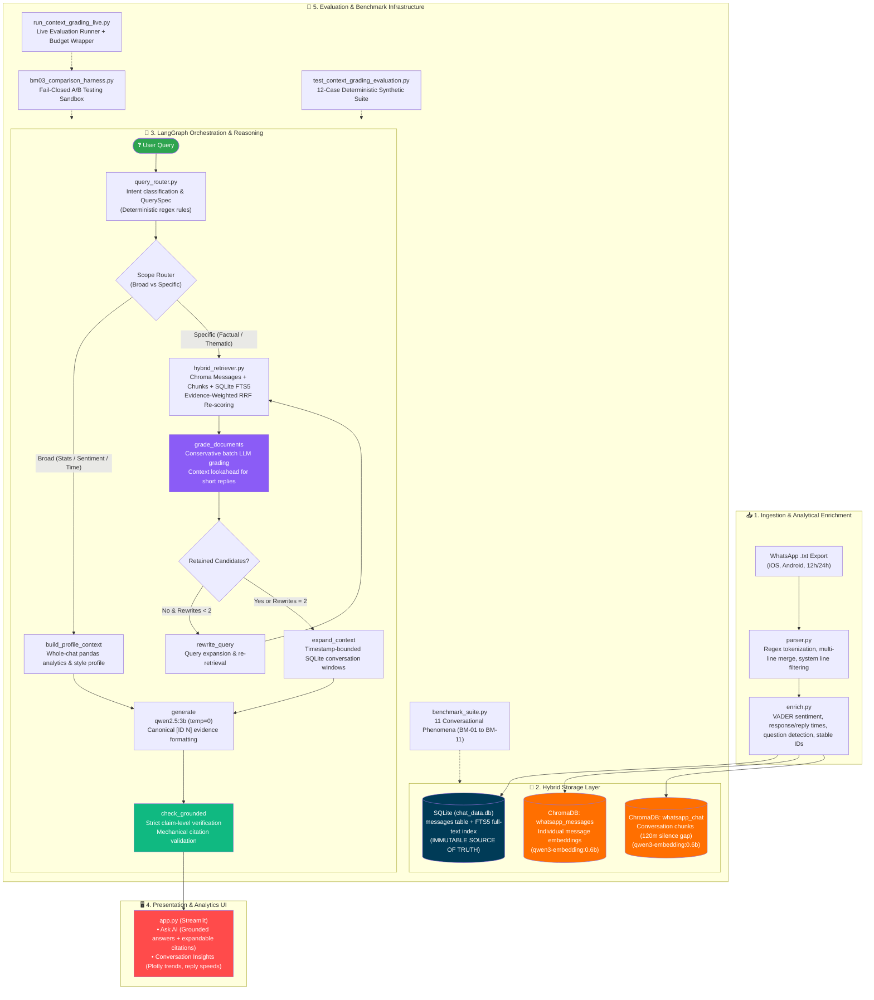

---

## 🧠 The LangGraph RAG State Machine

ChatLens orchestrates retrieval, evaluation, context expansion, and generation via an explicit **LangGraph** finite state machine.

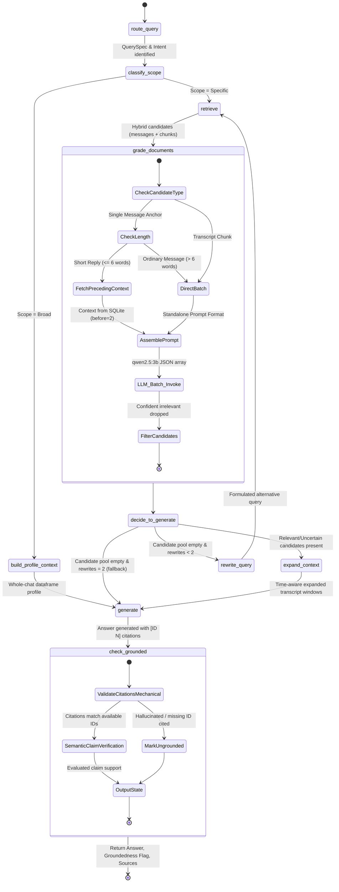

### Graph State Structure

```python
class GraphState(TypedDict, total=False):
    question: str                         # Active query (rewritten if retried)
    original_question: str                # User's raw question
    documents: List[Document]             # Active evidence candidates
    generation: str                       # LLM response text
    rewrite_count: int                    # Retry counter (capped at 2)
    grounded: bool                        # Strict final groundedness boolean
    semantic_grounded: bool               # LLM semantic claim verdict
    df: Optional[pd.DataFrame]            # Enriched dataset for broad analytics
    scope: str                            # "broad" or "specific"
    primary_intent: str                   # Classified intent enum
    secondary_intents: List[str]          # Mixed secondary intents
    query_spec: Optional[QuerySpec]       # Extracted entities and constraints
    citation_validation: Optional[dict]   # Detailed mechanical validation report
    valid_citation_ids: List[int]         # IDs cited that exist in context
    invalid_citation_ids: List[int]       # Hallucinated citation IDs
    available_citation_ids: List[int]     # All message IDs present in final prompt
    grader_status: Optional[str]          # "success" or "failure" (fail-open)
    evidence_mode: str                    # "standard" or "dialogue_evidence_unit"
    dialogue_evidence_mode: Optional[bool]# Opt-in feature flag override
    database_path: Optional[str]          # Isolated SQLite path (for testing/sandboxing)
    embedding_function: Optional[Any]     # Injected embedding function for scoring/ranking
```

---

## 🎯 Context-Aware Relevance Grading

In real chat archives, many of the most critical answers are **short or elliptical replies**:
- *"In Vault 9."* (answering *"Where did we store the backup SSL certificate?"*)
- *"At noon."* (answering *"When is the team standup?"*)
- *"Yes."* / *"Cancelled."* / *"Sub-level 4."*

When evaluated in isolation, single-message retrieval anchors lacking nouns or context are routinely discarded by standard LLM relevance graders as unhelpful fragments (causing severe **false negatives** and recall collapse). Conversely, naively merging preceding messages directly into document content causes **citation pollution** and phantom evidence attribution.

### The ChatLens Solution: Bounded Context Lookahead with Document Immutability

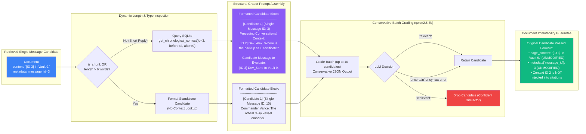

### Key Engineering Safeguards:
1. **Dynamic Scope Control**: Long messages (`> 6` words, `> 35` chars) and conversation chunks (`source == "conversation_chunk"`) bypass SQLite context lookups entirely, preserving processing latency.
2. **Structural Labeling**: Preceding context is labeled distinctly under `Preceding Conversational Context:`, while the candidate under review is isolated under `Candidate Message to Evaluate:`. The model evaluates whether the candidate is relevant *given* the context.
3. **Strict Document Immutability**: Neither `page_content` nor `metadata` of the candidate `Document` is modified during grading. Preceding messages remain ephemeral prompt hints. Context expansion occurs only *after* grading.
4. **Fail-Open Graceful Degradation**: If SQLite is temporarily unavailable, or context returns empty, grading automatically falls back to standalone candidate evaluation without raising exceptions. Syntax errors in JSON parsing default safely to `"uncertain"`, retaining the document for downstream validation.

---

## 🔀 Opt-In Dialogue-Evidence Retrieval Pipeline

In Tasks 35, 36, and 37, architectural analysis revealed that routing retrieved candidates through an isolated LLM-based `grade_documents` node acts as an irreversible filter: short, highly context-dependent replies (*"In Vault 9."*, *"14:00"*, *"Confirmed."*) risk permanent rejection before surrounding conversational context can be assembled.

ChatLens introduces an **opt-in alternative retrieval architecture**:
$$\textbf{Retrieve anchors} \longrightarrow \textbf{Assemble dialogue units} \longrightarrow \textbf{Rank complete units (RRF)} \longrightarrow \textbf{Select bounded top-K} \longrightarrow \textbf{Generate} \longrightarrow \textbf{Validate citations}$$

This bypasses the LLM relevance grader as a hard pre-filter, instead assembling complete chronological dialogue windows around message anchors and scoring full conversational transcripts.

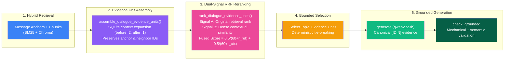

### Key Architectural Invariants:
1. **Preserved Citation Provenance**: Every turn in an assembled dialogue unit carries its original `message_id`, `sender`, and `timestamp`. The anchor message is clearly marked with `[ANCHOR: message_id]` to distinguish the retrieved claim from neighboring context.
2. **Contextual Transcript Scoring (Signal B)**: Dense cosine similarity is computed between the user query and the *complete assembled transcript*, enabling short elliptical messages to rank well when their surrounding context satisfies the query.
3. **Deterministic Reciprocal Rank Fusion (RRF)**:
   $$\text{fused\_score}(d) = \frac{0.5}{60 + \text{rank}_{\text{ret}}(d)} + \frac{0.5}{60 + \text{rank}_{\text{ctx}}(d)}$$
   Ties are broken deterministically via `(-fused_score, -contextual_similarity, retrieval_rank, anchor_message_id)`.
4. **Safe Degradation**: If embeddings cannot be calculated or an error occurs, the ranker falls back safely to pure retrieval order (`contextual_ranking_status="fallback_retrieval_order"`). Candidates are never silently discarded.
5. **Zero Interference with Production**: The experimental path is disabled by default. When disabled, the production graph runs `grade_documents` and the legacy pipeline with zero behavioral drift.

### Activating the Experiment:

- **Via Environment Variable**:
  ```bash
  export CHATLENS_DIALOGUE_EVIDENCE_EXPERIMENT=1
  ```
- **Via Python API**:
  ```python
  from rag_graph import ask

  response = ask(
      "Where did Alex leave the keys?",
      dialogue_evidence_mode=True
  )
  print(f"Evidence Mode: {response['evidence_mode']}") # "dialogue_evidence_unit"
  ```

---

## 🔎 Dual-Level Hybrid Retrieval Engine

ChatLens rejects simple vector search in favor of a 3-way hybrid retrieval and evidence-scoring architecture that balances semantic nuance with keyword precision:

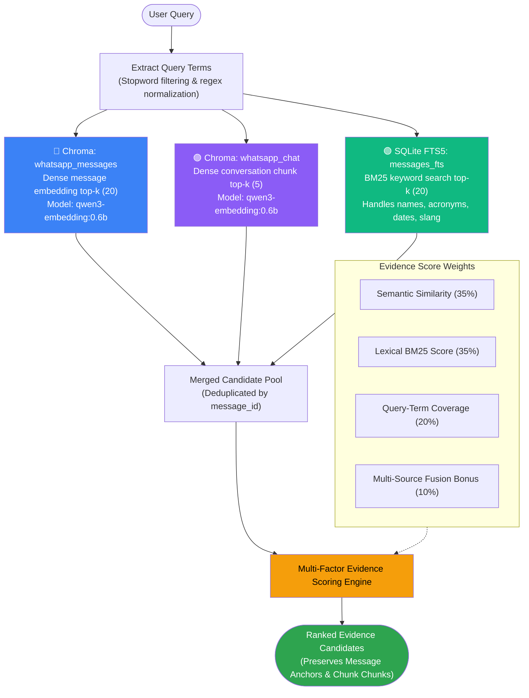

---

## 🪟 Timestamp-Aware Context Expansion

A standalone hit like `"[ID 4] Specialist Lyra: Sub-level 4."` cannot be understood by the final generator without surrounding dialogue. `context_expander.py` expands retained anchors using **real temporal gaps** rather than fixed sentence windows:

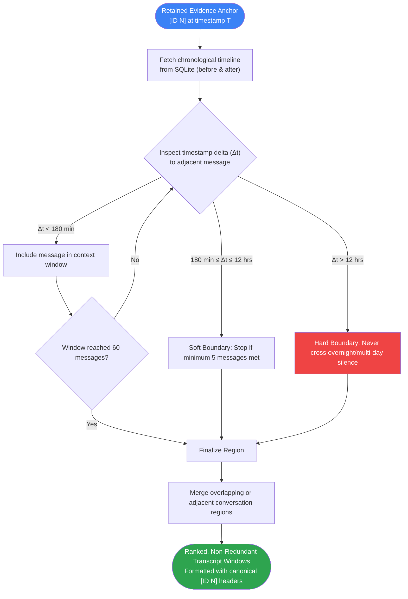

---

## 🧭 Deterministic Query Routing

To prevent broad behavioral questions from clogging hybrid retrieval, `query_router.py` employs a zero-LLM deterministic classification engine:

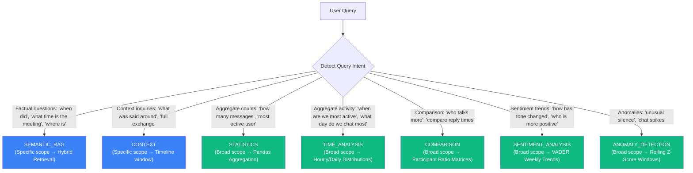

---

## 🔄 Ingestion & Enrichment Pipeline

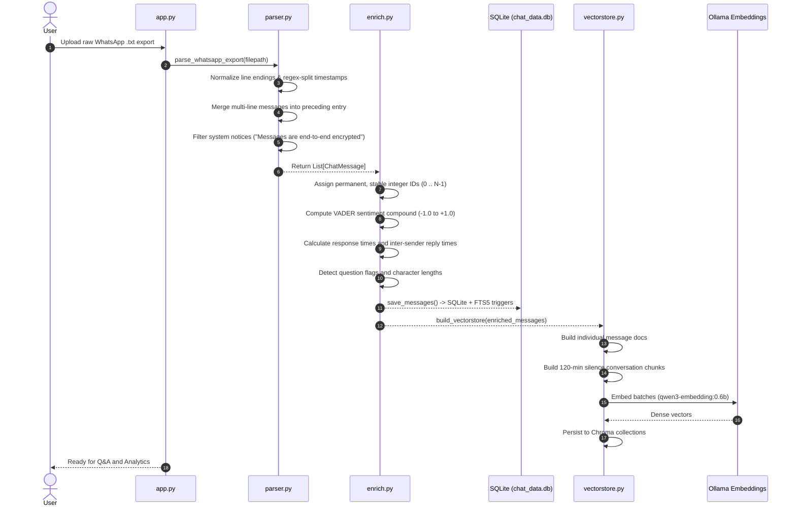

---

## 🗄️ Relational & Vector Data Model

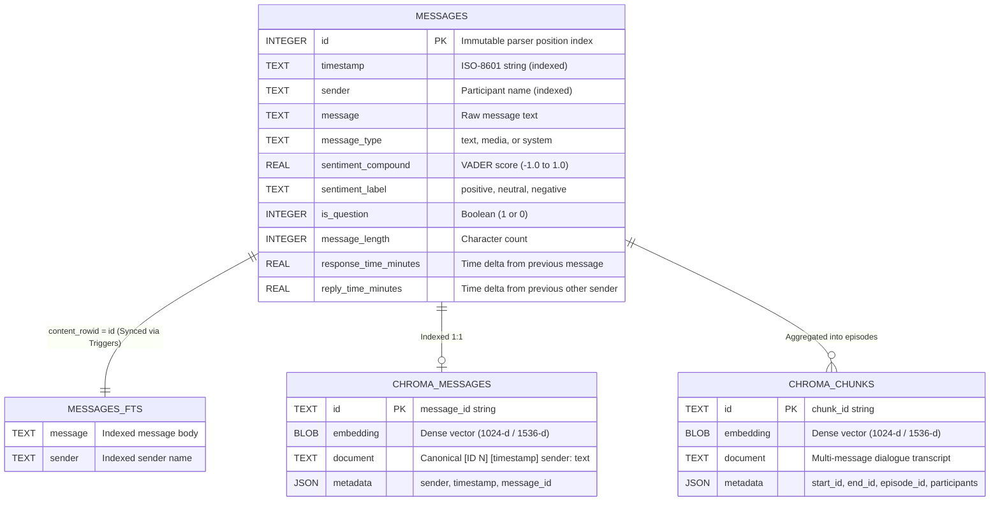

---

## 📊 Analytics & Behavioural Dashboard

The **Conversation Insights** tab runs entirely on deterministic `pandas` aggregations without synthetic LLM scoring:

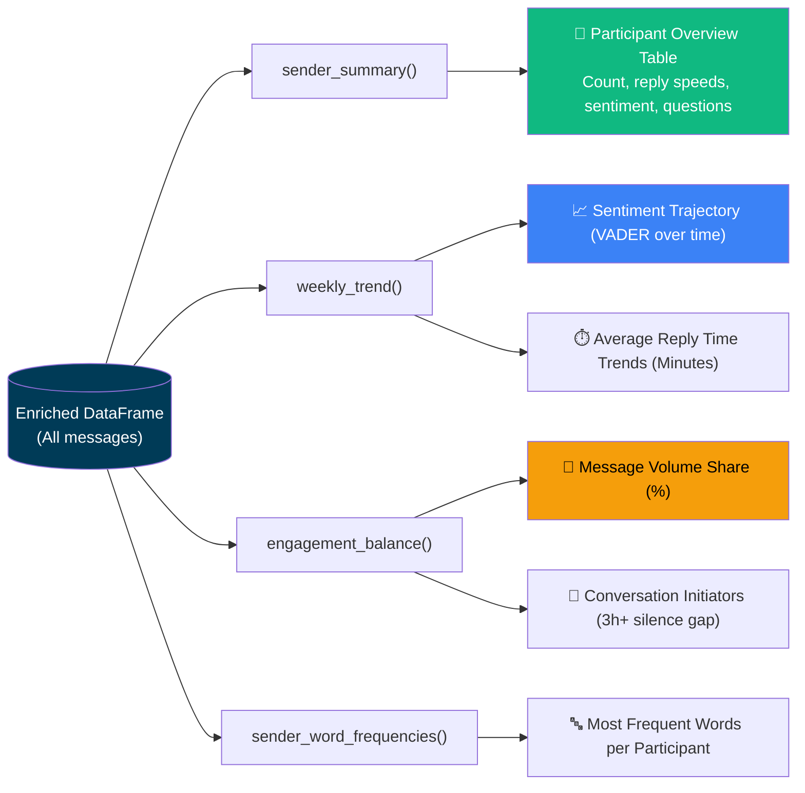

---

## 🧪 Universal Benchmark & Evaluation Infrastructure

ChatLens includes an automated, rigorous benchmark suite in [`benchmark_suite.py`](file:///c:/Users/vibhor/Desktop/chat_lens_v2/ChatLens-RAG/benchmark_suite.py) testing 11 core conversational phenomena:

| Case ID | Phenomenon Tested | Description | Target Evaluation Contract |
| :--- | :--- | :--- | :--- |
| **BM-01** | **Direct Fact** | Explicit single-message factual statement | Minimal sufficient evidence `[0]`; distractor `[8]` rejected |
| **BM-02** | **Semantic Paraphrase** | High semantic overlap with near-zero lexical overlap | Accurately matches paraphrase without FTS5 keyword assistance |
| **BM-03** | **Short-Reply Context** | Elliptical short reply (`In Vault 9.`) whose meaning depends on preceding inquiry | Pre-grading context supplies antecedent; `[3]` or `[2, 3]` cited |
| **BM-04** | **Pronoun Anaphora** | Resolves pronouns ("He mentioned...") to earlier referent | Minimal sufficient evidence `[5]`; contextual pair `[4, 5]` valid |
| **BM-05** | **Multi-Message Synthesis** | Answer requires combining facts across distinct messages | Strictly requires citing both `[6, 7]`; partial citation fails recall |
| **BM-06** | **Absent Answer** | Unanswerable query absent from conversation | **Clean abstention**: zero valid/invalid citations; True Negative (TN) |
| **BM-07** | **Lexical Distractor** | High lexical overlap message about an irrelevant topic | Distractor message `[8]` must be excluded from citations |
| **BM-08** | **Temporal Revision** | Fact updated later in time (rescheduled meeting) | Cites current update `[10]`; rejects superseded appointment `[9]` |
| **BM-09** | **Density & Burst Variations** | Dense rapid-fire chat logs vs sparse statements | Measures context window isolation under varying message densities |
| **BM-10** | **Bilingual / Hinglish** | Code-mixed queries (*"Kal ka client presentation kitne baje hai?"*) | Retrieves across Hindi/English code-switching without translation |
| **BM-11** | **Bilingual Short Reply** | Short reply in code-mixed conversation (*"Added to slide 8."*) | Resolves referent across language boundaries |

### Benchmark Metrics Calculated Deterministically:
- **Anchor Retrieval Recall @ k**: Proportion of expected anchor IDs retrieved in the initial top-$k$ candidate pool.
- **Context Availability Recall @ k**: Proportion of ground-truth evidence IDs present in the final prompt context after grading and expansion.
- **Citation Validity Rate**: Percentage of generated citations that correspond to valid, existing messages in context.
- **Attribution Precision**: Fraction of cited message IDs that belong to the pre-declared acceptable evidence sets ($1.0$ = zero irrelevant or hallucinated citations).
- **Attribution Recall**: Fraction of required evidence IDs successfully cited ($1.0$ = complete evidence coverage).
- **Correct Abstention Rate**: Percentage of unanswerable questions where the system cleanly abstains without generating citations.
- **Grounding Confusion Matrix**: Full True Positive (TP), True Negative (TN), False Positive (FP), and False Negative (FN) categorization.

---

## 🛡️ Fail-Closed Benchmark Sandbox Architecture

To evaluate the system safely without corrupting user data or production databases, ChatLens includes a **fail-closed comparison harness** ([`bm03_comparison_harness.py`](file:///c:/Users/vibhor/Desktop/chat_lens_v2/ChatLens-RAG/bm03_comparison_harness.py)):

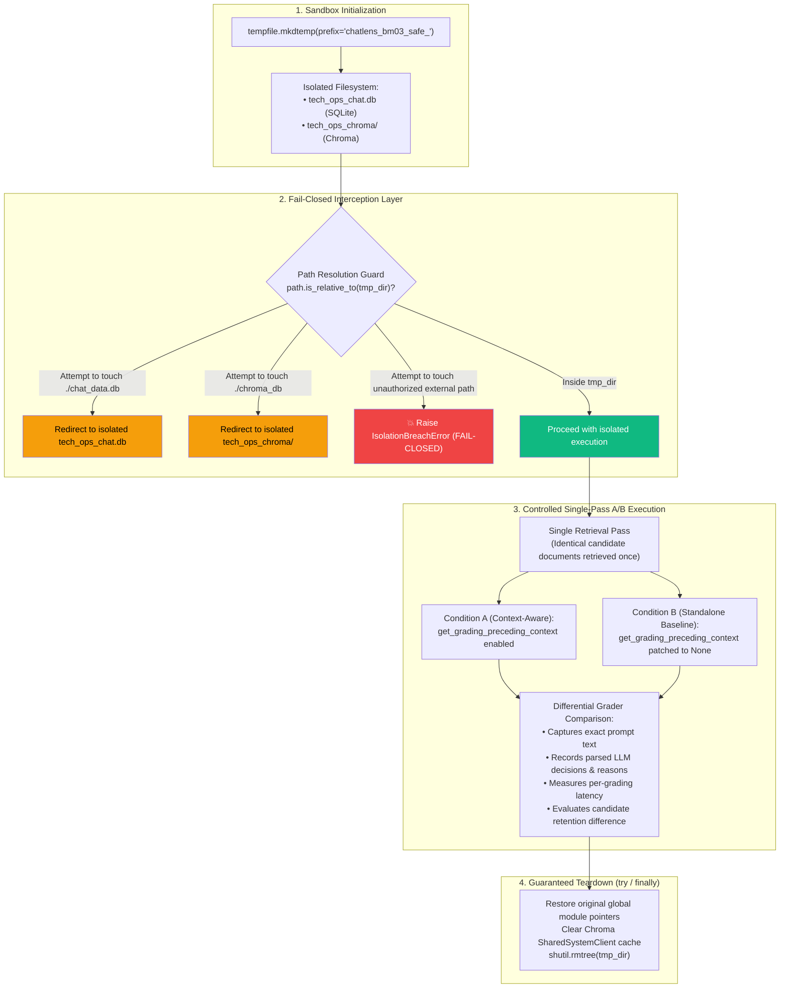

---

## ⚖️ 12-Case Context Grading Suite & Runtime Budget Enforcement

To rigorously measure whether context lookahead improves relevance grading without introducing hallucinations or false positives, ChatLens provides:
1. **12-Case Deterministic Evaluation Suite** ([`test_context_grading_evaluation.py`](test_context_grading_evaluation.py)): A fully deterministic offline diagnostic suite covering 12 distinct synthetic conversational scenarios with predefined expected labels.
2. **Live Multi-Case Grading Evaluation Runner** ([`run_context_grading_live.py`](run_context_grading_live.py)): An opt-in evaluation harness for real local models with strict dry-run protection and active runtime budget enforcement.

### The 12 Synthetic Evaluation Phenomena

| Case ID | Category | Query Example | Candidate Message | Preceding Conversational Context | Expected Label | Standalone (B) | Context-Aware (A) | Impact |
|:---:|:---|:---|:---|:---|:---:|:---:|:---:|:---|
| **CASE-01** | Terse Location | Where was the backup SSL certificate placed? | *"In Vault 9."* | Alice: Where did we store the backup SSL certificate? | `relevant` | `irrelevant` (FN) | `relevant` (TP) | **Recovered** |
| **CASE-02** | Short Time | What time is the production deployment window scheduled for? | *"9pm."* | Bob: When does the deployment window begin tonight? | `relevant` | `irrelevant` (FN) | `relevant` (TP) | **Recovered** |
| **CASE-03** | Pronoun Anaphora | Where can I find the incident root cause report? | *"It is in the second folder."* | Ken: Has anyone seen the incident root cause report? | `relevant` | `irrelevant` (FN) | `relevant` (TP) | **Recovered** |
| **CASE-04** | Yes/No Confirmation | Did the database migration script succeed on staging? | *"Yes, completely clean."* | Chris: Did the migration script finish successfully? | `relevant` | `irrelevant` (FN) | `relevant` (TP) | **Recovered** |
| **CASE-05** | Misleading Context | Where is the staging API key stored? | *"On the kitchen counter."* | Alex: Where did you leave the cafeteria keys? | `irrelevant` | `irrelevant` (TN) | `irrelevant` (TN) | **Invariant (No FP)** |
| **CASE-06** | Self-Contained Positive | What is the primary IP address for the Redis cache cluster? | *"The primary IP address for the Redis cache cluster is 10.0.4.15."* | *(None needed)* | `relevant` | `relevant` (TP) | `relevant` (TP) | **Invariant** |
| **CASE-07** | Self-Contained Negative | What is the primary IP address for the Redis cache cluster? | *"Pizza sounds great for lunch today."* | Chris: Anyone ordering lunch today? | `irrelevant` | `irrelevant` (TN) | `irrelevant` (TN) | **Invariant** |
| **CASE-08** | Context Distractor | Who approved the firewall port change? | *"I think the weather is going to be stormy this evening."* | Security: Who approved the firewall port change? | `irrelevant` | `irrelevant` (TN) | `irrelevant` (TN) | **Invariant (No FP)** |
| **CASE-09** | Multi-Message Exchange | Which server rack is experiencing power fluctuation? | *"Confirmed, heavy voltage drops."* | Monitor: Rack C4 power sensor throwing warnings.<br/>Ops: Can anyone confirm on site? | `relevant` | `irrelevant` (FN) | `relevant` (TP) | **Recovered** |
| **CASE-10** | Ambiguous Abstention | Did the Kubernetes pod autoscaler trigger? | *"Maybe."* | Alex: Checking general system alerts. | `irrelevant` *(Abstain)* | `uncertain` (Abstain) | `uncertain` (Abstain) | **Invariant** |
| **CASE-11** | Similar Entity Distractor | Where is the production JWT secret stored? | *"In secrets.dev.json."* | Test: Where did we save the dev test JWT token? | `irrelevant` | `irrelevant` (TN) | `irrelevant` (TN) | **Invariant (No FP)** |
| **CASE-12** | Ordinary-Length Bypass | What is the backup retention policy for user data? | *"Our compliance policy requires retaining all daily user database snapshots for 90 days before archiving."* | *(Bypassed - length > 6 words)* | `relevant` | `relevant` (TP) | `relevant` (TP) | **Invariant** |

### Runtime Inference Budget Enforcement Architecture

To guarantee that live local model experiments can never run unchecked, spawn infinite retries, or exceed token/hardware allocations, `run_context_grading_live.py` employs a stateful **`BudgetEnforcingLLMWrapper`**:

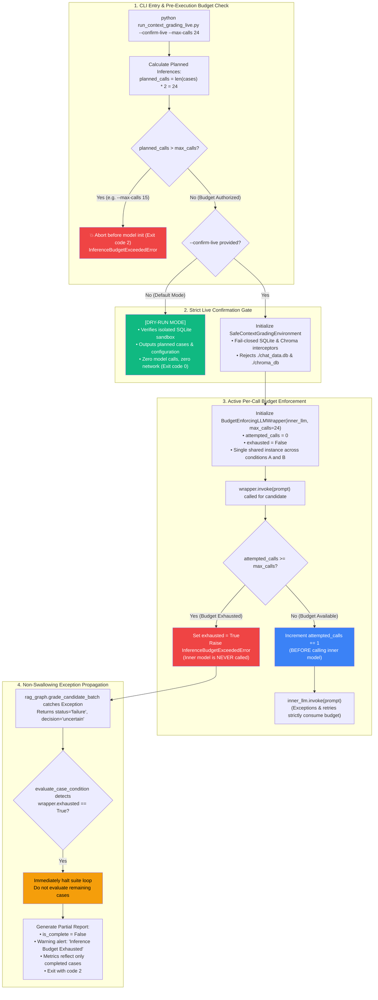

### Metrics & Mathematical Grounding
- **Decisive Coverage**: Percentage of candidates receiving a definitive (`relevant` / `irrelevant`) decision: $\frac{N_{\text{decisive}}}{N_{\text{total}}}$.
- **Abstention Rate**: Percentage of candidates where the model abstained as `uncertain`: $\frac{N_{\text{uncertain}}}{N_{\text{total}}}$.
- **Decisive Accuracy**: Classification accuracy over decisive outputs: $\frac{\text{TP} + \text{TN}}{N_{\text{decisive}}}$.
- **Strict Accuracy**: Conservative metric treating abstentions as classification errors against ground truth: $\frac{\text{TP} + \text{TN}}{N_{\text{total}}}$.

---

## 🛠️ Tech Stack

| Layer | Component | Version / Implementation | Role |
| :--- | :--- | :--- | :--- |
| **LLM Inference** | [Ollama](https://ollama.com) | `qwen2.5:3b` (temp=0) | Relevance grading, query rewriting, answer generation, groundedness check |
| **Embeddings** | [Ollama](https://ollama.com) | `qwen3-embedding:0.6b` | Dual-level semantic embeddings for messages and chunks |
| **Orchestration** | LangGraph & LangChain | `langgraph >= 0.2`, `langchain-core` | State graph workflow, conditional edges, retry loops |
| **Vector Database** | ChromaDB | `chromadb >= 0.5`, `langchain-chroma` | Dense vector indexing across `whatsapp_messages` and `whatsapp_chat` |
| **Relational Store** | SQLite3 + FTS5 | Standard Library | Single source of truth, chronological context lookups, BM25 keyword search |
| **Analytics Engine** | pandas & numpy | `pandas >= 2.0` | Deterministic trend calculations, reply speeds, initiator metrics |
| **Sentiment** | VADER | `vaderSentiment` | Rule-based compound sentiment scoring on ingestion |
| **User Interface** | Streamlit & Plotly | `streamlit >= 1.35`, `plotly` | Interactive chat Q&A, source citation explorer, visual analytics dashboard |
| **Test Suite** | pytest | `pytest >= 8.0` | Comprehensive unit, regression, offline evaluation, and sandbox tests |

---

## 📂 Project Directory Structure

```text
ChatLens-RAG/
│
├── app.py                             # Streamlit UI (Ask AI tab + Conversation Insights tab)
├── parser.py                          # Multi-format WhatsApp .txt parser & cleaner
├── enrich.py                          # Feature enrichment (sentiment, response times, stable IDs)
├── chat_database.py                   # SQLite schema, FTS5 triggers, context window queries
├── vectorstore.py                     # Dual Chroma collections (individual messages + chunks)
│
├── query_router.py                    # Deterministic intent routing & QuerySpec extraction
├── hybrid_retriever.py                # 3-way retrieval fusion & multi-factor evidence scoring
├── context_expander.py                # Time-aware context window expansion around anchors
├── rag_graph.py                       # LangGraph state machine with context-aware grading
├── analytics.py                       # Deterministic pandas statistics & Plotly aggregations
│
├── benchmark_suite.py                 # 11-phenomenon universal evaluation benchmark runner
├── bm03_comparison_harness.py         # Fail-closed A/B testing harness for BM-03 grading
├── run_context_grading_live.py        # Safe live evaluation runner with runtime budget enforcement
│
├── test_context_grading_evaluation.py # 12-case deterministic offline grading evaluation suite
├── test_run_context_grading_live.py   # Unit tests for live runner confirmation gate & budget wrapper
├── test_relevance_grading.py          # Unit tests for context-aware grading (Cases A-F)
├── test_controlled_grading_comparison.py # Controlled offline A/B grading comparison suite
├── test_bm03_comparison_harness.py    # Unit tests for fail-closed sandbox and path guards
├── test_universal_benchmark.py        # Offline benchmark metrics & policy contract tests
├── test_evaluation_harness.py         # Synthetic dataset evaluation harness tests
├── test_query_router.py               # Deterministic query router test suite
├── test_hybrid_retriever.py           # Hybrid retrieval fusion unit tests
├── test_ingestion_pipeline.py         # WhatsApp export parser and enrichment tests
├── test_real_smoke_test.py            # Live dependency smoke test (requires local Ollama)
│
├── Requirements.txt                   # Project dependencies
└── README.md                          # System documentation
```

---

## 🚀 Quick Start Guide

### 1. Prerequisites
- **Python 3.10+** (Python 3.12 recommended)
- **[Ollama](https://ollama.com/download)** installed and running locally on `http://127.0.0.1:11434`

### 2. Pull Required Local Models
```bash
ollama pull qwen2.5:3b
ollama pull qwen3-embedding:0.6b
```

### 3. Clone and Setup Environment
```bash
git clone https://github.com/vVIBHORj/chatlens_v2.git
cd chatlens_v2/ChatLens-RAG

# Create virtual environment
python -m venv venv

# Activate virtual environment
# Windows (PowerShell):
.\venv\Scripts\Activate.ps1
# macOS / Linux:
source venv/bin/activate

# Install dependencies
pip install -r Requirements.txt
```

### 4. Export WhatsApp Chat
1. Open any WhatsApp chat on your phone.
2. Tap **Settings / More** (`⋮`) → **Export chat**.
3. Choose **Without Media**.
4. Save the `.txt` export to your machine.

### 5. Launch the Streamlit Interface
```bash
streamlit run app.py
```
Upload your `.txt` export in the sidebar, wait for automated indexing, and start asking questions!

---

## ⚙️ Configuration Reference

Key pipeline parameters can be configured directly in their respective modules:

| Parameter | Location | Default | Description |
| :--- | :--- | :--- | :--- |
| `MAX_REWRITES` | `rag_graph.py` | `2` | Maximum query reformulation retries if retrieval finds no evidence |
| `GRADE_BATCH_SIZE` | `rag_graph.py` | `10` | Maximum candidate documents evaluated in a single LLM grading prompt |
| `SEMANTIC_EXPANSION_MAX_WORDS`| `rag_graph.py` | `6` | Word threshold triggering preceding context lookahead for short replies |
| `SEMANTIC_EXPANSION_MAX_CHARS`| `rag_graph.py` | `35` | Character threshold triggering context lookahead |
| `MAX_HYBRID_CANDIDATES` | `rag_graph.py` | `20` | Candidate pool size passed to relevance grading |
| `MESSAGE_SEMANTIC_TOP_K` | `hybrid_retriever.py` | `20` | Top individual message hits from Chroma |
| `CHUNK_TOP_K` | `hybrid_retriever.py` | `5` | Top conversation chunk hits from Chroma |
| `LEXICAL_TOP_K` | `hybrid_retriever.py` | `20` | Top keyword hits from SQLite FTS5 |
| `EPISODE_GAP_MINUTES` | `vectorstore.py` | `120` | Inactivity silence threshold defining a new conversation episode |
| `NORMAL_GAP_MINUTES` | `context_expander.py` | `180` | Soft conversational boundary for context expansion |
| `HARD_GAP_HOURS` | `context_expander.py` | `12` | Absolute hard temporal boundary never crossed during expansion |

---

## 🧪 Testing & Diagnostics Suite

ChatLens provides a comprehensive, multi-tiered test suite that can be run completely offline without Ollama:

```bash
# 1. Run the 12-case offline context grading evaluation suite
python -m pytest test_context_grading_evaluation.py

# 2. Run the live evaluation runner verification tests (confirmation gate & budget wrapper)
python -m pytest test_run_context_grading_live.py

# 3. Run all offline relevance grading tests (prompt structure, immutability, scope control)
python -m pytest test_relevance_grading.py

# 4. Run the controlled context-aware vs standalone comparison tests
python -m pytest test_controlled_grading_comparison.py

# 5. Run the fail-closed BM-03 comparison harness tests (path guards, sandboxing)
python -m pytest test_bm03_comparison_harness.py

# 6. Run the universal benchmark policy and metrics tests
python -m pytest test_universal_benchmark.py

# 7. Run the query router classification tests
python -m pytest test_query_router.py

# 8. Run the deterministic dialogue evidence unit assembly tests (Task 36)
python -m pytest test_context_expander.py -v

# 9. Run the opt-in dialogue-evidence retrieval pipeline tests (Task 37)
python -m pytest test_dialogue_evidence_pipeline.py -v

# 10. Run citation integrity, fail-closed validation, and grounding tests
python -m pytest test_citation_integrity.py -v

# 11. Execute all offline grading, sandboxing, and evaluation tests in one pass
python -m pytest test_run_context_grading_live.py test_context_grading_evaluation.py test_bm03_comparison_harness.py test_controlled_grading_comparison.py test_relevance_grading.py test_context_expander.py test_dialogue_evidence_pipeline.py test_citation_integrity.py
```

### Multi-Case Live Grading Evaluation Runner
The evaluation runner tests the 12 synthetic cases against local models. By default, it operates in safe dry-run mode without invoking inference:

```bash
# Dry run: validates configuration, isolation sandbox, and outputs the plan (0 model calls)
python run_context_grading_live.py

# Live execution: strictly requires explicit opt-in flag (enforces max budget of 24 model calls)
python run_context_grading_live.py --confirm-live
```

### Live Benchmark Execution (Requires Local Ollama)
When local models are running and authorized, execute the full 11-case benchmark suite:
```bash
python benchmark_suite.py
```

---

## 🔐 Privacy, Safety & Responsible Use

- **100% On-Device Processing**: Ingestion, vector storage, BM25 indexing, embedding generation, relevance grading, and text generation all execute on your local hardware. No chat messages or metadata leave your machine.
- **Fail-Closed Sandboxing**: Automated benchmarks and test evaluations run inside isolated temporary sandboxes with strict guards preventing accidental reads or writes to production databases.
- **Runtime Inference Budget Enforcement**: Live evaluation runners wrap the LLM with a hard call counter (`BudgetEnforcingLLMWrapper`) that fails closed before exceeding authorized inference quotas.
- **Local Evidence Transparency**: Every answer includes inspectable message IDs, timestamps, and senders. ChatLens never generates claims without displaying the evidence that supported them.
- **Data Hygiene**: The `.gitignore` file strictly blocks all `.txt` exports, `.db` files, and `chroma_db/` folders from being tracked by Git. Never commit private personal chat exports.

---

## 🗺️ Project Status & Roadmap

### ✅ Completed Milestones
- [x] Multi-format WhatsApp parsing with continuation line merging and system line filtering.
- [x] Dual-level Chroma vector indexing (individual messages + conversation episodes).
- [x] SQLite FTS5 synchronized relational storage (Source of Truth).
- [x] Deterministic 8-intent query routing with factual-time vs aggregate-activity disambiguation.
- [x] Hybrid 3-way retrieval fusion with query-term coverage and multi-source evidence scoring.
- [x] Timestamp-aware context expansion respecting conversational silence boundaries.
- [x] Conservative batch relevance grading with bounded context lookahead for short replies.
- [x] Candidate document immutability preventing phantom context ID citation pollution.
- [x] Universal evaluation benchmark suite covering 11 core conversational phenomena.
- [x] Fail-closed isolated A/B comparison testing harness with strict path guards.
- [x] 12-case deterministic offline context-aware grading evaluation suite across 6 core conversational categories.
- [x] Controlled live grading evaluation runner with explicit confirmation gate and dry-run default.
- [x] Strict runtime LLM inference budget enforcement (`BudgetEnforcingLLMWrapper`) preventing runaway model calls.
- [x] Deterministic metrics engine (attribution precision/recall, citation validity, abstention).
- [x] Deterministic dialogue evidence unit assembly preserving exact message anchor provenance and chronological boundaries (Task 36).
- [x] Opt-in dialogue-evidence retrieval pipeline with dual-signal RRF contextual ranking, top-K bounding, and zero-breakage production gating (Task 37).
- [x] Mechanical and semantic citation integrity suite with fail-closed validation for synthetic, legacy, and chunk evidence.

### 🚀 Upcoming Roadmap
- [ ] Execute authorized live multi-case grading evaluation against local `qwen2.5:3b`.
- [ ] Add streaming response token generation in the Streamlit UI.
- [ ] Add interactive message context graph visualization in the UI.
- [ ] Optimize Chroma embedding batch throughput on multi-year chat exports (>50,000 messages).
- [ ] Add optional exportable PDF/HTML conversation summary reports.

---

<div align="center">

**ChatLens** · Engineered for grounded conversation intelligence.

</div>
